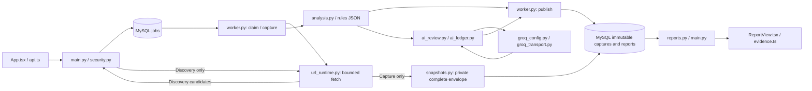

# TermsLens architecture and debugging

Trace code against the frozen [requirements](plan-proposal.md) and [F1-F8 contracts](implementation-workflow.md#stage-contracts-and-persistence). See the [checklist](verification-checklist.md) for acceptance and [handoff](transfercontext.md) for current state.

## Current execution path



The API commits before returning 202. A separate worker claims, captures, analyzes and atomically publishes report rows plus terminal job/result link. The browser polls. Production uses MySQL; SQLite is supplementary test storage.

Paste/URL/reanalysis jobs support rules-only or consented hybrid. Publication verifies baseline/provenance/extractor identity; missing Groq readiness causes fallback. Comparisons/deletion are implemented; reviewed library and runtime acceptance remain pending.

| Contract / responsibility | Code entry points | Focused checks |
|---|---|---|
| F1 accounts, origin/CSRF, sessions; F2 validation/idempotency | [main.py](apps/api/app/main.py), [security.py](apps/api/app/security.py) | [test_storage.py](apps/api/tests/test_storage.py), [test_mysql.py](apps/api/tests/test_mysql.py) |
| F2-F3 claim, lease, capture; F6 publication | [worker.py](apps/api/app/worker.py) | [test_worker.py](apps/api/tests/test_worker.py), MySQL acceptance |
| F2-F3 URL/discovery, snapshot recovery and source metadata | [URL architecture](url-fetching.md), `url_*.py`, [snapshots.py](apps/api/app/snapshots.py), [URLInput.tsx](apps/web/src/URLInput.tsx) | `tests.test_url_fetch`, `tests.test_url_runtime`, `tests.test_url_jobs`; real runtime pending |
| F4 segmentation/rules; F4/F7 scoring/profiles | [analysis.py](apps/api/app/analysis.py), [scoring.py](apps/api/app/scoring.py), versioned rules JSON | [test_analysis.py](apps/api/tests/test_analysis.py), [test_scoring.py](apps/api/tests/test_scoring.py) |
| F5 offline review, quota reservations and attempt recovery | [ai_contract.py](apps/api/app/ai_contract.py), [ai_ledger.py](apps/api/app/ai_ledger.py) | [test_ai_contract.py](apps/api/tests/test_ai_contract.py), [test_ai_ledger.py](apps/api/tests/test_ai_ledger.py); [test_ai_mysql.py](apps/api/tests/test_ai_mysql.py) is opt-in and unverified |
| F5 orchestration, baseline preservation and degradation | [ai_review.py](apps/api/app/ai_review.py) | [test_ai_review.py](apps/api/tests/test_ai_review.py); fake transport only |
| F5 readiness, bounded HTTP and child lifetime | [groq_config.py](apps/api/app/groq_config.py), [groq_transport.py](apps/api/app/groq_transport.py) | [test_groq.py](apps/api/tests/test_groq.py); fake HTTP, real local child deadlines and test-worker isolation |
| F2/F6 consent, legacy compatibility, baseline and owned AI provenance | [publication.py](apps/api/app/publication.py), main.py / models.py | [test_review_persistence.py](apps/api/tests/test_review_persistence.py); synchronous contracts only |
| F3/F7 versions, refresh/reanalysis and compatible reuse | [Version contracts](versions.md), versions.py / worker.py / main.py / DocumentHistory.tsx | `tests.test_versions`; MySQL/browser acceptance pending |
| F7/F8 comparisons/deletion | [Contracts and MySQL checks](comparisons-deletion.md), comparisons.py / deletion.py / snapshots.py | `test_comparisons`, `test_deletion`, `test_lifecycle_harness`; `test_lifecycle_mysql` prepared, unrun |
| UI consent, mode/baseline/source display, evidence | [ReviewOptions.tsx](apps/web/src/ReviewOptions.tsx), [App.tsx](apps/web/src/App.tsx), [ReportView.tsx](apps/web/src/ReportView.tsx), [evidence.ts](apps/web/src/evidence.ts) | [review.test.mjs](apps/web/tests/review.test.mjs), existing evidence/API tests; browser/manual checks pending |
| Database shape, configuration and readiness | [models.py](apps/api/app/models.py), [db.py](apps/api/app/db.py), [config.py](apps/api/app/config.py), [manage.py](apps/api/app/manage.py), [private setup](scripts/configure_database.py) | Private-config tests; migration/MySQL acceptance |
| Safe diagnostic events and job inspection | [diagnostics.py](apps/api/app/diagnostics.py) | [test_diagnostics.py](apps/api/tests/test_diagnostics.py) |

## Dependency boundaries

Local tests do not prove full MySQL/provider acceptance. Both utf8mb4 schemas are migrated; Groq needs verified accounting and durable quotas. Fake transport does not prove live operation.

Pins: [requirements.txt](apps/api/requirements.txt) / [requirements-dev.txt](apps/api/requirements-dev.txt), [package-lock.json](apps/web/package-lock.json). Use `.venv`.

Passwords are inside `.env` URLs. After MySQL rotation use `scripts/configure_database.py --replace-passwords` with `.venv` (README); it preserves the Groq key. Verify both logins.

`scoring.py` owns the rubric for rules, AI and publication. Stored `score_profiles` retain maxima/unknowns/caps for result and baseline. The UI switches locally without queries/writes/calls; older rubrics stay balanced-only. Revision: `plan-2026-10-26-profiles-v1`.

## Trace one failure

1. Capture the error's `Reference` value or the response's `X-Request-ID` in browser Network tools. The server creates this UUID; it is not a credential. Network failures before a response may have no reference.
2. A submission returns `job_id`. `job_queued` / `job_reused` events join its request to that job. The job stores the original submission `request_id`; each later poll has its own response reference.
3. Inspect the job's durable `state`, `stage`, `attempts`, `last_error_code` and `last_error_stage`. Follow `version_id` to the immutable capture and `result_id` to the published analysis/engine revisions.
4. Match `job_claimed`, `job_stage`, `job_rejected`, `job_interrupted`, `lease_lost` or `job_published` events by job ID. Database state is authoritative if a process dies between an event and a commit.
5. Reproduce at the first failing boundary using the table below. Add a focused regression check when fixing meaningful behavior, then run affected integration checks.

Run these in `apps/api`; choose the installed interpreter. The first command does not connect to the database or provider:

```powershell
../../.venv/Scripts/python.exe -m app.manage --diagnostics
../../.venv/Scripts/python.exe -m app.manage --migrations
../../.venv/Scripts/python.exe -m app.manage --job <job-uuid>
```

Use an actual `<job-uuid>`. `--test` selects `termslens_test` and clears provider settings. `--job` is a local read-only CLI: safe IDs, stages, leases, capture/report metadata, no text/tokens. Legacy jobs may lack request references.

`termslens.events` emits JSON to the API/worker terminal. `api_database_error` and `api_response` identify handled database failures and responses. Worker errors use fixed public codes/messages and exception class names. The frontend preserves response references on API errors. HTTP-level correlation still needs its runtime checklist check.

F5 events add `ai_dispatch_started` / `ai_dispatch_finished` with job/call UUIDs and `ai_review_finished` with fixed status/reason. Follow `call_id` to ledger metadata; bodies and raw exceptions remain private. Dispatch-finished follows the durable response/outcome commit.

| Symptom | First boundary to inspect | Evidence / next check |
|---|---|---|
| UI cannot load / request has no response | Built `dist`, API process, Vite proxy and host socket permissions | README start commands; browser Network tab; `/api/health`. |
| Login or mutation returns 401/403 | Session expiry, exact origin and CSRF header | Keep one host name consistently; inspect status/header presence without copying cookie/token values. Run HTTP security tests. |
| API 503 / worker unavailable | Interpreter, driver, DB URL, schema | Run `app.manage`: fixed login/connection/schema codes; see [code guide](RUNNING.md). `--diagnostics` is offline. |
| Job stays queued | Worker process, database selection, advisory lock | Inspect job; start the single worker with the same application configuration. |
| Job stays running / retries | Lease expiry/heartbeat, attempt count and failure stage | Inspect current lease metadata and worker events; expired work recovers within three attempts. Never reset attempts or edit lease tokens to force progress. |
| Job done but report unavailable | Atomic publication, owner join, tombstone | Follow result/version IDs; test reopening as the owner and denial for a second user. |
| URL capture failed | Fixed fetch code, snapshot integrity, schema head | `robots_denied`/`fetch_deadline` offer paste fallback; incomplete temporary files never count as captures. Do not overwrite saved captures to hide corruption. |
| Wrong/absent highlighting | Saved capture versus code-point offsets | `evidence_mismatch`, Unicode tests, and exact quote reproduction. Never edit saved text to fit a quote. |
| Unexpected grade / unknown category | Stored engine, applicable scope, clauses, caps | Run analysis tests; unknown evidence may correctly withhold a grade. Compare saved revisions before changing rules. |
| No AI findings | Requested/effective mode, review status/reason and health availability | Check readiness/consent and saved attempts. Disabled, expired or unverified settings cause fallback; accepted findings may also be zero after validation. |
| Hybrid unavailable again | Health `external_review.reason`, shown in both forms | For expired readiness, see [renewal](DEMO.md#when-ai-becomes-unavailable); preserve account evidence/usage, then refresh. |

`/api/health` checks API/database access and the jobs table, not migrations, worker activity or gate acceptance. Revisit blocked environment checks only when conditions change.

## Schema changes and recovery

Head `20261029_lifecycle` adds comparisons and deletion receipts after the [version migration](versions.md). Both real schemas passed revision checks in the user's terminal on 2026-10-30 (G1-05). For a fresh setup or future upgrade, stop API/worker and run from the root:

```powershell
.venv/Scripts/python.exe -m alembic -c apps/api/alembic.ini upgrade head
.venv/Scripts/python.exe -m alembic -c apps/api/alembic.ini -x test=true upgrade head
Push-Location apps/api
../../.venv/Scripts/python.exe -m app.manage --migrations
../../.venv/Scripts/python.exe -m app.manage --test --migrations
Pop-Location
```

Require both revision checks before restarting; both passed for the current workspace. Add migrations for new columns, update `SCHEMA_REVISION`/models and verify upgrades; never edit applied migrations.

Worker logs startup after acquiring its MySQL lock; waiting between jobs is normal. Ctrl+C releases the lock/disposes the engine cleanly. Leases fence stale holders across three attempts. Publication locks owner before job/document; fetch/files stay outside transactions. Atomic captures/publication recover interruptions; MySQL crash/race acceptance remains pending.

Discovery uses session/origin/CSRF, three requests/minute per user/IP and no jobs. It releases DB reads before fetching. UI timeout is 65 seconds; the server retains its 60-second bound after disconnect. `--test` isolates URL children and `var/tests/snapshots`. See [URL contracts](url-fetching.md).

Comparison 409 requires common settings/consent and reanalysis; delete 409 means an active job. Worker cleanup precedes claims; `cleanup_pending` retries in ten seconds. Inspect receipt/permissions privately. File locks/barriers fence stale writers. [Recovery checks](comparisons-deletion.md#prepared-mysql-acceptance) include SQL lock ordering, reconnects and test-child isolation; MySQL remains unrun.

## F5 configuration, dispatch and recovery

[README](README.md#groq-readiness-and-authorization) defines readiness/quotas. Worker/manage/MySQL tests use `Settings.from_env(test=True)`: test URL only, cleared provider settings, no production fallback. Local tests support fake transports.

`groq_readiness()` returns fixed reasons without calls; `configured` means local validation. Health/hybrid claims reread readiness. Restart API/worker for environment changes. Rules-only reads no readiness file or transport. See README.

The F5 ledger reserves/persists before `begin_dispatch()` commits `sending` once. `finish()` saves response/usage before validation. `recover()` fences interruptions and verifies capture/context/model/account/prompt identity; `saved_response()` reads compatible results. `app.manage --job` exposes safe attempt IDs/states.

Quota rows lock in stable order. Unknown/expired policy permits zero reservations. Charges last through dispatch deadline + window; verified same-generation usage permits refunds. Requests reserve <=6,000 input each and share 10,000 input/2,000 output, two requests/one retry/12 clauses. Larger first batches leave less retry capacity. Names cannot reset limits. Real locking: `scripts/check.py --mysql`.

The coordinator derives text/type/mode/consent from the leased job/capture and reuses saved responses before new work. F6 persists `ReviewOutcome` metadata and a compact rules baseline. Publication revalidates owned response evidence, scores and baseline preservation; each AI finding links to its call. Result rows, terminal job state and result link commit together. Degraded/limited outcomes use `partial`.

| Coordinator condition | Outcome |
|---|---|
| Rules-only or all substantive clauses already rated | Zero calls; `not_requested` / `not_needed`, effective rules-only. |
| Validated response, including uncertainty or rejected findings | Effective hybrid; rejected/uncertain clauses remain unrated. A zero-accepted result is not measured hybrid success. |
| Context/clause budget excludes work | `limited`, explicit per-clause reasons; accepted results can remain hybrid. |
| Provider/key/quota/unknown-outcome failure | `degraded`, effective rules-only, discard all AI findings from the returned result; keep saved responses and baseline. |
| Ownership/lease lost | Raise; no publishable result. |

`GroqTransport.send()` launches its child with credentials/payload on stdin. httpx sends once to the fixed endpoint, without proxies/redirects/internal retries. Caps: 128/64 KiB envelope/content, <=10s permit. Parent cleanup kills/reaps on timeout/error/interrupt; an independent child watchdog enforces the deadline. Late/nonzero/malformed replies are unknown.

HTTP 408/5xx/network/truncation outcomes are unknown; invalid/non-200 responses fail. Only 429 permits one retry with <=2s wait. Unknown outcomes retain reservations and never auto-resend. From `apps/api`: `python -m unittest tests.test_groq tests.test_ai_review -v`; no provider calls. README details the protocol.

Consent is a strict boolean for Groq, timestamped by the API and included in hybrid idempotency identity. Rules-only hashes retain the old field set. The UI clears consent on source/type/mode changes and reads availability from health. Report baseline switching is local; AI filters and source/model labels use saved provenance. Legacy null metadata is shown as unavailable, never recomputed with newer rules.

[Consumer demo](DEMO.md#consumer-walkthrough): 14/20 clauses rated locally; six fit AI preparation. General-policy blocker: analysis.py guards the whole document; ai_contract.py collects every exception paragraph. The reported 97-clause policy still selects zero. User narrowed scope to demo/allowance; context redesign and [human labels](eval/README.md) remain pending.

Keep private content, credentials, URLs and raw exceptions out of logs/handoffs. Use fixed codes and synthetic fixtures. Follow AGENTS; verify frozen inputs and document caps with `python scripts/check_context.py`.
