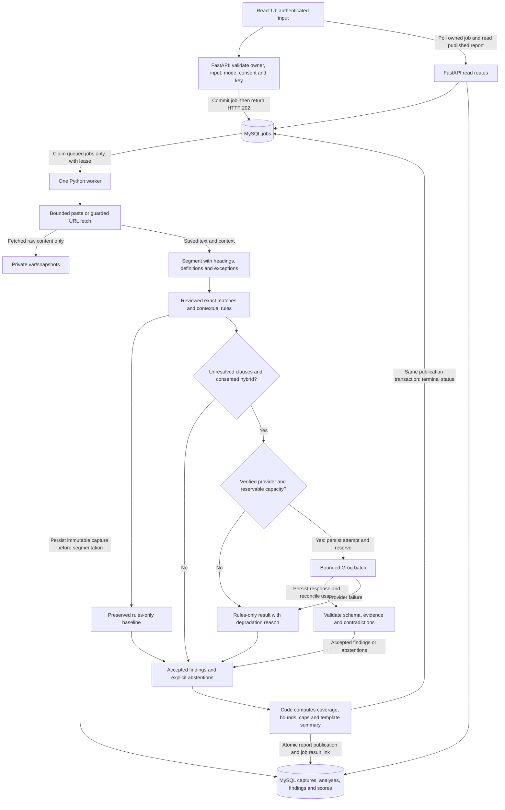
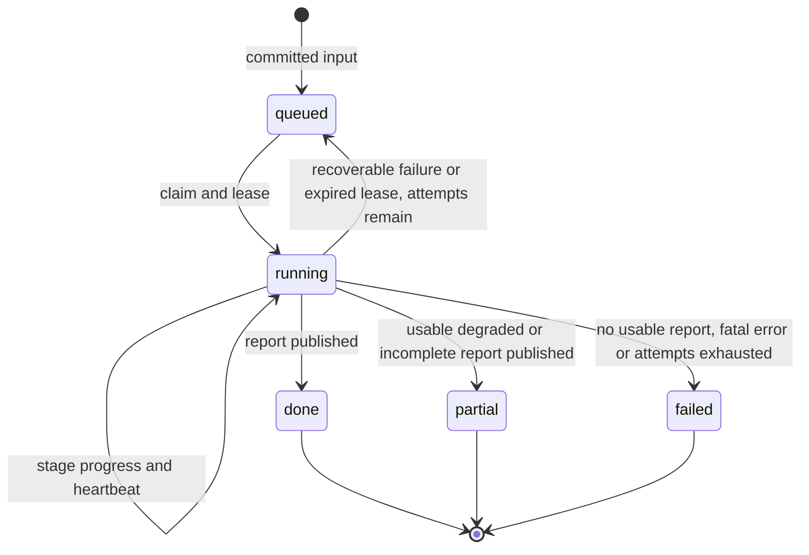

# TermsLens implementation workflow and data flow

Reference date: 2026-10-28. This is an implementation contract; it does not assert that features or checks already exist.

## Frozen baseline and reference order

- [plan-proposal.md](plan-proposal.md) is the frozen baseline. Preserve its bytes and requirements throughout implementation.
- This reference explains execution and data boundaries. If it conflicts with the plan, the plan governs; correct the reference without changing requirements.
- [transfercontext.md](transfercontext.md) holds current progress, actual checks, blockers and authorization. Historical planning text does not authorize implementation or external calls.
- Code choices/fixes may evolve within scope. For infeasible requirements, record the blocker/proposal in the handoff and obtain user direction before deviating. Never rewrite the plan or declare reduced scope complete.
- Preserve the supplied [source brief](TermsLens_Project_Plan.md) and Assignment_10_Report.pdf. The final plan controls where the older brief differs.

Baseline SHA-256: `5400bc0097636187ed106b3e3fcf6cc913d5e88334393402ebb466461e14040e`.

From the project root, this read-only check fails if the plan has changed:

```powershell
python -c "from pathlib import Path; import hashlib; assert hashlib.sha256(Path('plan-proposal.md').read_bytes()).hexdigest() == '5400bc0097636187ed106b3e3fcf6cc913d5e88334393402ebb466461e14040e', 'Frozen plan changed'; print('Frozen plan: PASS')"
```

## User workflow

1. Register or log in. Choose one English policy type, paste text or select a public policy URL, and choose rules-only or hybrid with explicit external-review consent.
2. For a homepage, request discovery and select one of up to four candidates. Discovery does not start analysis or combine documents.
3. Submit, receive a job ID and poll actual stages. The same owner/key/input returns that job; different input under that key returns 409.
4. Open the owned report: requested/effective mode, scope/capture date, coverage, score bounds, category findings, source labels, uncertainty and exact highlighted evidence.
5. Reopen private history after restart. Manually refresh a URL or replace pasted text to check versions. Compare compatible reports and switch balanced/privacy-first views using stored findings.
6. Delete an owned document when it has no active job; cleanup includes dependent reports/comparisons and snapshots. Log out to invalidate the session.

Keyboard access, visible focus, textual severity, escaped policy text and clear progress/error/unknown states apply throughout. Never render fetched raw HTML as a page.

## Main data flow



Discovery separately returns candidates using the same fetch protections. Groq receives selected clauses/context only, with no database, filesystem or tool access.

## Stage contracts and persistence

F1-F8 provide stable task/check references. All reads/writes derive ownership from the authenticated session or persisted job, never a client-supplied owner ID.

| Stage | Input and responsible component | Durable output / boundary |
|---|---|---|
| F1 Authenticate | API: register/login/logout and `/me`. | `users`, hashed expiring `sessions`; Argon2id, cookie/origin/CSRF/rate controls. Logout invalidates the session. |
| F2 Enqueue | API: `/analyses` or owned refresh/reanalysis; source, type, mode, consent and idempotency key. | Owner-scoped `jobs` with input/consent/requested mode committed before 202. Claiming a job never grants another owner's access. |
| F3 Capture | Worker: bounded paste, guarded URL or owned saved capture. | `documents`, ordered immutable `document_versions`, cleaned text/headings/hash/time/extractor metadata; private raw snapshot when fetched. Reanalysis retains the capture. |
| F4 Interpret locally | Worker: saved text/context and versioned rules/library. | Analysis revision, contextual `clauses`, rule/exact-match findings or abstentions. Preserve actors, definitions, negation, numbers and exceptions. |
| F5 Interpret with AI | Worker adapter: unresolved clauses, adequate context, consent, verified model/budget. | `ai_calls` attempts/responses/usage and locked `ai_budget_windows`; accepted findings retain model/prompt provenance; rejected, uncertain and excluded clauses remain unrated. |
| F6 Publish | Worker: baseline, accepted findings and explicit unknowns. | `analyses`, `clause_findings`, `category_scores`; publish report, one job result FK and terminal status/effective mode atomically. Partial writes are not readable reports. |
| F7 Read and compare | API: owned reports/captures, filters and profile. | Paginated history/evidence; `comparisons` only for compatible analyses. Profiles calculate from stored findings without fetching or AI. |
| F8 Delete | API plus recoverable cleanup: owned document, no active job. | Tombstone blocks new work/attachments; remove dependent comparisons/data and retry snapshot cleanup before finalizing deletion. |

Evidence points to the immutable cleaned capture using Unicode code-point offsets. Convert for JavaScript UTF-16 or render server-provided slices; test non-BMP highlighting. Findings can span categories, but duplicates cannot inflate coverage or dilute risk.

Use the [database/API contracts](plan-proposal.md#database-and-api). Build in `apps/web`, `apps/api`, `eval` and private `var/snapshots`; version rules/taxonomy/templates/library in source. Keep keys in environment storage and snapshots outside public assets.

## Job states, transactions and recovery



- Store stage separately from state. `done`/`partial` expose one report/effective mode; `failed` exposes a bounded error. Unrated clauses can remain in completed jobs.
- One worker/active job initially; three total attempts. Claims, attachments, AI reservations, publication and deletion enforce ownership/tombstones transactionally. Recovery cannot duplicate captures/results.
- Replacing a lease revokes the old worker's publication rights. Recover saved work/responses; never requeue terminal jobs, reset AI budgets or automatically replay completed/interrupted calls.
- Persist attempts/reservations before sending and responses/usage before interpretation; reconcile conservatively. Unknown provider outcomes retain consumed/reserved capacity and degrade without automatic resend.
- Publish report and job result/status together. Snapshot cleanup survives filesystem/database failures. Never log policy bodies, passwords or keys.

## AI decision and scoring contract

1. Run reviewed exact matches and contextual rules first; retain the baseline. Keywords prioritize unresolved substantive clauses; unfamiliar wording is not neutral by default.
2. Rules-only sends nothing. Hybrid requires explicit consent and verified free provider/model/account limits. Provider readiness failure produces visible degradation; unknown quotas permit zero calls.
3. At most twelve clauses, six per batch, two requests total including retries and at most one retry. Reserve across active quota windows; total input/output ceilings are 10,000/2,000 tokens, with stricter real limits prevailing. A retry consumes capacity otherwise available for another batch.
4. Include headings, nearby text and relevant definitions. If context cannot fit without losing an exception, abstain. Treat policy text as untrusted data; one model, no tools/escalation/automatic learning.
5. Validate IDs/schema/enums/severity, exact evidence and supported-rule contradictions. Quotes establish provenance, not correct interpretation. Accept supported outputs with labels; uncertain, conflicting, invalid and budget-excluded outputs remain unrated.
6. Compute the exact [rubric and coverage](plan-proposal.md#rubric-and-coverage) in code: fixed type scope, maxima, unknown bounds, caps and grade conditions. Do not average away concerns, treat missing evidence as safety, or have AI assign the overall grade.
7. Store requested/effective mode, provenance, baseline and unresolved reasons. Provider/key/quota failure yields visibly degraded rules-only output; it does not satisfy hybrid acceptance. Human-labeled evaluation establishes measured quality.

See [Required bounded AI](plan-proposal.md#required-bounded-ai) for authoritative limits. Mocked responses do not demonstrate working free access or measured AI value.

## Versions, reuse, profiles and deletion

| Trigger | Required flow | Correctness check |
|---|---|---|
| Identical refresh | Guarded fetch/paste; compare against latest capture; reuse compatible analysis and record check time on the job. | No duplicate version or unnecessary AI call. Incompatible settings require reanalysis with valid consent. |
| Changed/reverted text | Serialize refresh with document row locking; create next immutable version. Rerun cheap rules across all context. | A -> B -> A creates three versions; changed definitions can affect unchanged passages. Concurrent refreshes preserve order. |
| Reanalysis | Read owned capture, apply settings/valid consent, create immutable analysis revision. | Original capture/findings remain available; distinguish rerun interpretations. |
| Version comparison | Same logical document and common engine/mode/model/prompt/profile; exact passage alignment then bounded similarity. | Separate text changes from settings/AI changes; similarity does not approve meaning. |
| Cross-policy comparison | Owned reports with matching type/applicable groups and common settings; reanalyze incompatible captures with consent. | Same comparison basis; never silently compare hybrid against degraded rules-only. |
| Profile switch | Reweight stored maxima/unknowns over the fixed applicable groups. | No fetch, AI call or mutation of saved findings. |
| Delete/restart cleanup | Reject active jobs, tombstone transactionally, block attachments/refresh/reanalysis, remove derived records/comparisons and snapshots. | User B cannot affect user A; interrupted cleanup resumes before finalization. |

Reuse identity includes owner, document/version/context, engine/library/rubric/mode, hybrid model/prompt/rerun revision and view profile revision. No cross-user reuse. See [Versions, comparisons and reuse](plan-proposal.md#versions-comparisons-and-reuse) for full compatibility requirements.

## Implementation order and gate exits

For each gate: check authorization, build the smallest complete slice, verify, and record results/commands in the handoff. Present deliverables before a new phase; seek approval only if it is not already authorized. Failed checks stay pending without weakening requirements.

| Gate | Entry and build order | Required exit evidence |
|---|---|---|
| 1. Persisted slice | Confirm course constraints; real MySQL login and isolated `termslens_db`/`termslens_test`; pinned dependencies/migrations, then F1 -> F2 -> F3 paste -> F4 three groups -> F6 -> F7. | Install/build and migrations; two users, queued paste, Unicode evidence, private report and restart/reopen. Record three checkpoint groups; full scope remains pending. |
| 2. Intelligence | Prepare labels/heldout split before tuning; all eight groups/rubric/library. Verify free model/account/quotas early; add F5 consent/reservations/validation/fallback. | Novel/exception cases, budget/retry/crash checks, rules-only zero calls, degraded modes and authorized real hybrid smoke run. Final evaluation remains Gate 5. |
| 3. URL workflow | Guarded discovery/F3 URL capture, metadata and real progress. | Before arbitrary URLs: DNS/IP/redirect/size/deadline tests, robots/domain throttling and worker crash checks. At most four candidates; paste for dynamic/blocked pages. |
| 4. Novelty | Complete F7 history, refresh/reanalysis, versions/diffs/comparisons/profiles and F8 deletion. | Isolation, idempotency, context/cache invalidation, compatible comparisons, profile no-call behavior, revert/concurrent refresh and deletion recovery. |
| 5. Finish | Both-mode evaluation, benchmarks, end-to-end/build; then visual refinement, actual screenshots and course report. | All scoped features, persistence/degraded mode, evaluated AI, benchmark results, keyboard/browser demo and exact Windows README commands. Disclose unmet targets/unavailable hybrid. |

Current preflights belong in the [handoff](transfercontext.md). MySQL client presence cannot pass Gate 1. Radnus/native/GPU work and the plan's deferred features are not startup prerequisites or implementation scope.

## Verification map and completion evidence

Use the gate exits above as the check map, tracing work to F1-F8. Exercise real MySQL API/worker/restart/isolation and recovery; use fake providers/network for schema/evidence/injection/conflict/429/timeout cases. Separately authorized live hybrid calls prove provider operation.

Apply all [operational boundaries](plan-proposal.md#operational-boundaries): public HTTP(S), ports 80/443, all DNS answers checked, Host/TLS-correct pinning, redirects revalidated, and exact network/input limits. Check session/CSRF controls, tombstones and ownership on every read/write; test keyboard/browser behavior and non-BMP evidence end to end.

- Follow the plan's [dataset counts, heldout split, adversarial pairs and quality targets](plan-proposal.md#delivery-gates-and-acceptance). People label examples; prevent tuning leakage. Report actual counts, precision/recall, macro F1, abstention/coverage and shortfalls for both modes.
- Follow the [fixed benchmark protocol and targets](plan-proposal.md#performance-and-radnus-hpc). Record median/p95 and separate startup, queue, network and AI time.
- README supplies exact Windows DB/dependency/API/worker/web/evaluation/benchmark commands and environment names without secrets. Until then, retain real commands/results in the handoff.
- Verify the plan hash and document caps: workflow <=200 lines/16 KiB; handoff <=60 lines/6 KiB. Replace stale status in the one current handoff.
