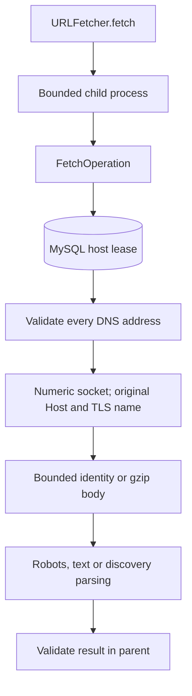

# Guarded URL capture and discovery

This implements F3 URL capture and homepage discovery under the frozen [plan](plan-proposal.md#operational-boundaries), including API/UI, private snapshots and worker recovery. Local tests pass; real MySQL/HTTP/browser acceptance is pending. The research collector is separate.

## Boundaries

| Component | Responsibility |
|---|---|
| [url_runtime.py](apps/api/app/url_runtime.py) | `URLFetcher.fetch`: private stdin protocol, parent deadline/child cleanup, independent watchdog, bounded and validated results. |
| [url_fetch.py](apps/api/app/url_fetch.py) | One capture/discovery operation; shared request/redirect budget, robots checks, per-host slots and elapsed-time checks. |
| [url_guard.py](apps/api/app/url_guard.py) | URL normalization, all-answer DNS validation, numeric socket connection, TLS/Host preservation, bounded response decompression. |
| [url_robots.py](apps/api/app/url_robots.py) | Agent groups, longest allow/disallow matches, wildcard/end-anchor and percent-encoding rules, crawl intervals. |
| [url_content.py](apps/api/app/url_content.py) | Static text/headings with exact offsets, charset handling and up to four typed same-origin link candidates. |
| [url_throttle.py](apps/api/app/url_throttle.py) | Transactional `fetch_hosts` leases shared across processes; quiet intervals and stale-holder fencing. |
| [snapshots.py](apps/api/app/snapshots.py) / worker.py | Private completion envelopes, recovery without refetching, lease-fenced attachment and stored capture metadata. |
| main.py / [URLInput.tsx](apps/web/src/URLInput.tsx) | Authenticated input/discovery, explicit selection, consent reset and bounded cancellable discovery requests. |



The normal entry point is `URLFetcher`, with an explicit database URL and `test` selection. Production requires `termslens_db`; tests require `termslens_test`. There is no fallback between them. Database credentials travel on stdin, never argv or HTTP headers. The child does not load `.env`; inherited Groq and database credential variables are removed. Neither provider calls nor application jobs are created by this service.

`FetchOperation` is the synchronous implementation inside that boundary. Direct calls are for injected offline tests; callers must use the process boundary for real DNS/network work so a blocked resolver, socket, database or parser cannot defeat the total deadline.

## Network and parsing contracts

- Accept HTTP/HTTPS URLs up to 2,048 characters, on ports 80/443. Reject credentials, controls, backslashes, ambiguous numeric hosts and invalid escapes. Normalize IDNA hosts, default ports and fragments; retain query semantics.
- Every DNS answer must be public IPv4/IPv6. Reject private, loopback, link-local, multicast, reserved and transition/mapped address forms. An empty, oversized or mixed public/private answer set fails before connecting.
- Connect a socket to one validated numeric address, with no second DNS lookup. Verify the peer address. HTTPS uses the system trust store and the original hostname for certificate/SNI checks; HTTP uses the original Host header. No proxy, cookie jar, authentication or automatic retry is used.
- Each operation allows at most eight HTTP requests, including robots/redirects, and three total redirect hops. Every redirect target is validated and its DNS checked before its request. A policy redirect to another public origin gets that origin's robots check.
- Discovery and robots redirects remain on their starting origin, including scheme/port. HTTP-to-HTTPS redirects therefore need the HTTPS URL supplied directly for discovery. No cross-origin candidate or automatic candidate fetch is allowed.
- Bound both compressed and decompressed response bodies to 2 MiB. Support identity/gzip only; reject bad lengths, truncation, invalid gzip and concatenated gzip members. No partial response is accepted as a policy.
- The parent allows at most 60 seconds including process startup. The child independently bounds its operation, and the HTTP socket timeout is at most ten seconds within the remaining budget. Timeouts/interrupts kill and reap the child. There is no retry inside this service.
- Robots 404/410 permits fetching; 401/403 denies it. Other errors, unreadable robots, unsupported redirects and malformed rules fail closed. Merge matching agent groups; longest match wins and allow wins a tie. Empty rules do not prohibit access; unknown directives do not split groups.
- Host slots serialize requests across schemes/ports/processes for each normalized hostname. Enforce at least one second after completion, or the largest observed robots crawl-delay/request-rate interval. A later lower interval does not reset the saved restriction. Busy hosts fail without a network request; waits must fit the operation deadline.
- Commit a host lease before DNS/HTTP, without holding a database transaction across network work. Its expiry fits the operation budget. Completion releases only the same token and records a quiet interval; a dead child leaves an expiring lease. Real MySQL concurrency remains an acceptance check.
- Decode declared charsets strictly; recognize a bounded HTML charset declaration when needed. Preserve Unicode text, headings and nearby exceptions. Exclude scripts/styles and semantic navigation/footer/forms from policy text; retain navigation links for discovery. Never execute or serve source HTML.
- Limit cleaned text to 200,000 characters/25,000 words. Empty static pages, known challenge titles, unsupported formats and explicitly non-English pages return fixed failure codes for paste fallback. Missing language metadata does not certify English or policy relevance.

## Result and persistence contract

Capture returns original/final URLs, retrieval time, request/redirect counts, elapsed time, content type, extractor revision `static-policy-v1`, cleaned text and heading offsets. It includes SHA-256 hashes and base64 of the decompressed response body. `raw_representation` explicitly identifies that body; the hash is not a hash of compressed wire bytes.

Discovery returns up to four unique same-origin URLs with suggested policy types and link labels. It reports scan/static-page limitations and an empty-result paste fallback. It returns no combined policy text and creates no analysis. Candidate types are suggestions for explicit selection, not reviewed labels.

The parent validates the result type, request bounds, source identity, capture hashes/heading offsets, or candidate origins/counts. Errors expose only fixed allowlisted codes. URLs, source text and raw exception details belong in private storage, never diagnostic logs.

`POST /api/analyses` accepts one of `text`, `url` or owned `version_id`, plus type/mode/consent/idempotency. It commits before 202; submission never fetches. Paste/URL hashes are preserved. Limits: ten submissions/minute per user/IP, five active per owner. [Version contracts](versions.md) cover refresh/reanalysis and compatible reuse.

`POST /api/discovery` accepts `{ "url": "https://example.com/" }` with session/origin/CSRF checks and three calls/minute per user and IP. It releases its read transaction before network work and creates no jobs. The UI offers explicit candidate selection, resets consent on input/type changes, and renders source values as text. Discovery has a 65-second client allowance and cancellation; a disconnected server operation still ends within its own 60-second bound.

Snapshots live at `var/snapshots/<owner>/<job>/<request-hash>.json`, never in web assets. Each envelope includes owner/job/request identity and the complete capture, including raw bytes encoded as base64. Write a unique temporary file, flush/fsync, then complete atomically without overwriting an existing winner (Windows rename; POSIX hard link). A partial temporary file is never a capture. Paths, identity, hashes, extractor and heading offsets are checked on recovery; corrupt completed captures fail instead of refetching silently. Document deletion removes associated completed/temporary job files with OS locks and stale-write barriers; see [cleanup contracts](comparisons-deletion.md). Unattached failed jobs and unrelated files are not swept.

The worker fetches and saves outside DB transactions while its heartbeat remains active, then rechecks the lease before attaching. A process crash after file completion but before attachment reuses that capture on retry. Source metadata, retrieval time and heading offsets are persisted with the version; rules and hybrid baselines retain the extractor identity, and publication checks it. Reports exclude raw bytes and storage paths. Test workers use only `termslens_test` and `var/tests/snapshots`.

Real MySQL host-lease races/recovery, URL jobs and browser behavior still require acceptance evidence before closing Gate 3.

## Verification and migration

From `apps/api`, run `../../.venv/Scripts/python.exe -m unittest tests.test_url_fetch tests.test_url_runtime tests.test_url_jobs -v`. The 32 core tests retain their prior pass; 15 new integration tests pass for completion/recovery, lease fencing, metadata/ownership, consent hashes, test selection and discovery auth/rates. SQLite/fake HTTP and local files/children only; no public/provider calls. `scripts/check.py` includes them.

Migration `20261029_url` adds `fetch_hosts`; `20261029_capture` adds URL input/capture metadata; `20261029_versions` adds version/reuse support. Head `20261029_lifecycle` adds comparisons/deletion. Generate upgrades without secrets or a connection:

```powershell
.venv/Scripts/python.exe -m alembic -c apps/api/alembic.ini upgrade 20261028_review:head --sql
```

`migrations/env.py` inserts the exact API directory into Python's import path. This avoids Alembic 1.13's space/colon splitting on Windows. Offline generation does not read `.env` or create a database engine. Real migration execution remains part of the deferred database verification documented in the handoff.
